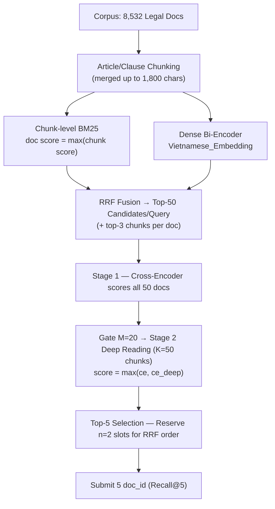

# Vietnamese Legal Document Retrieval (DSC 2026 — Task 1)

> **Two-stage Legal Information Retrieval Pipeline: Hybrid Candidate Generation (BM25 + Dense Bi-Encoder via RRF) → Deep-Chunk Cross-Encoder Reranking & Slot-Reservation Blending**

[](https://github.com/Loc2116/DSC2026_Task-1)
[](REPRODUCE.md)
[](data/README.md)

---

## 📌 Project Overview

This project builds a retrieval and reranking system for **Vietnamese legal documents** (**8,532 documents**): given a natural-language legal query, the system returns the **top-5 relevant documents** evaluated by **Recall@5** (achieving **0.9124 Recall@5** on the public leaderboard, finishing **Top 30/80**).

### Two-Part System Architecture

| Stage | Responsibility | Repository |
|---|---|---|
| **Part 1 — Candidate Generation** | Chunk-level BM25 ⊕ Dense Bi-Encoder (`Vietnamese_Embedding`), fused with RRF → top-50 candidates/query | **[justySusanto/Task1_Retrieval](https://github.com/justySusanto/Task1_Retrieval)** |
| **Part 2 — Reranking & Top-5 Selection** | Two-stage Cross-Encoder with deep chunk reading + slot-reservation blending → top-5 `doc_id` | **This repository** |

---

## 🔄 Retrieval & Reranking Pipeline



* **`M`**: Number of top-ranked documents passed into Stage 2 deep chunk reading.
* **`K`**: Maximum chunks scored per document during deep reading.
* **`n`**: Number of top-5 output slots reserved for the initial RRF candidate order (`blend_bm25_first`).

---

## 📊 Experimental Progression (Public Leaderboard — Recall@5)

| Experiment / Change | Recall@5 | Δ |
|---|---:|---:|
| Baseline Cross-Encoder reranking | 0.8350 | — |
| + Reserve 2 slots for initial candidate order | 0.8573 | **+2.23** |
| + Deep multi-chunk reading per doc (`M=20, K=20`) | 0.8840 | **+2.67** |
| + Chunk selection via chunk-level BM25 (1,800 chars) | 0.8871 | +0.31 |
| + Switch candidate pool to **RRF fusion** (BM25 ⊕ Dense) | 0.9063 | **+1.92** |
| + Increase `M=10 → M=20` | 0.9109 | +0.46 |
| + Align retrieval embedding model with reranker | 0.9118 | +0.09 |
| + Increase `K=20 → K=50`, slot reservation `n=2` | **0.9124** | +0.06 |

**Key takeaway:** The two largest gains came from **input quality & coverage**—deep chunk reading (**+2.67**) and RRF candidate fusion (**+1.92**)—rather than hyperparameter tuning.

---

## 🔍 Error Analysis & Key Findings

1. **Why Slot-Reservation Blending Outperforms Score Fusion:**
   * On the 300-query dev set, pure cross-encoder reranking (`568M` params) pulled **14** missed documents into top-5, but pushed **22** true documents out (net **−8 queries**, scoring `0.9100` vs. `0.9117` for raw RRF order).
   * Reserving `n=2` slots for the RRF order isolates reranker regressions to the remaining `5−n` slots, outperforming z-score, min-max, and rank-RRF blending across all tested parameters.
2. **Model Size vs. Domain Alignment:**
   * Across 15,000 benchmarked pairs ([`docs/bang_ablation.md`](docs/bang_ablation.md)), `mmarco-mMiniLMv2` (`0.118B`) achieved `R@5 = 0.7217`, outperforming `ViRanker` (`0.568B`, `0.6867`) by **+3.50 points** while being 4.8× smaller and 16× faster.
3. **Documented Negative Results:**
   * Full fine-tuning with hard BM25 top-20 negatives degraded performance (`−0.50` to `−6.50`), and pairwise top-2 arbitration overfit dev (`+2.33` on dev, `−1.4` on test). Full experiment logs are documented in [`docs/HUONG_DA_DONG.md`](docs/HUONG_DA_DONG.md).

---

## 📁 Repository Structure

```text
├── src/         # Python modules: chunking, deep reading, reranking, blending, metrics
├── notebooks/   # Kaggle experiment & submission notebooks
├── docs/        # Ablation tables & negative-results documentation (Vietnamese)
├── results/     # Precomputed dev score/order JSONs for CPU-only analysis
├── data/        # Data instructions (competition corpus/labels not redistributed)
├── REPRODUCE.md # Step-by-step reproduction guide
└── requirements.txt
```

> **Note:** On Kaggle, files in `src/` were uploaded flat into a dataset and added via `sys.path.append`, so notebooks import modules directly (e.g., `from deep_chunk import ...`).

### Key Entrypoints
* `src/deep_chunk.py` — Article/clause chunking, `pick_chunks`, and `deepen_all`
* `src/rerank_from_d.py` — Candidate scoring and `blend_bm25_first` slot-reservation blending
* `src/metrics.py` — Competition `Recall@k` evaluation with unit tests
* `src/k_tran.py` — CPU ceiling analysis and submission validation checks
* `notebooks/fusion_v3_run.ipynb` — Main `Recall@5 = 0.9124` submission pipeline

---

## 🚀 CPU-Only Analysis Reproduction

All ablation numbers and blending analyses can be verified on CPU in seconds from `results/`:

```bash
pip install -r requirements.txt
python - <<'PY'
import json
sc = json.load(open('results/dev300/scores_dev300_moc_k3.json'))
ro = json.load(open('results/dev300/order_dev300_matchEmb.json'))

def select_top_k(sc_q, ro_q, n, k=5):
    """Reserve n top slots for RRF candidate order, fill remaining with reranker."""
    ranked = sorted(sc_q, key=lambda d: -sc_q[d])
    out = []
    for d in list(ro_q[:n]) + ranked + list(ro_q):
        if d not in out:
            out.append(d)
        if len(out) >= k:
            break
    return out[:k]

print(select_top_k(sc['29410'], ro['29410'], n=2))
PY
```

---

## 📚 Documentation & Exclusions

* [`REPRODUCE.md`](REPRODUCE.md) — Reproduction steps, artifact checksums, and hardware notes
* [`docs/HUONG_DA_DONG.md`](docs/HUONG_DA_DONG.md) — Closed experimental directions & methodological rules (Vietnamese)
* [`docs/bang_ablation.md`](docs/bang_ablation.md) — Cross-encoder ablation benchmark on 15,000 pairs (Vietnamese)
* **Excluded from Git:** Competition corpus/queries (see [`data/README.md`](data/README.md)), public test prediction files, and large `.npy` / candidate cache files.
